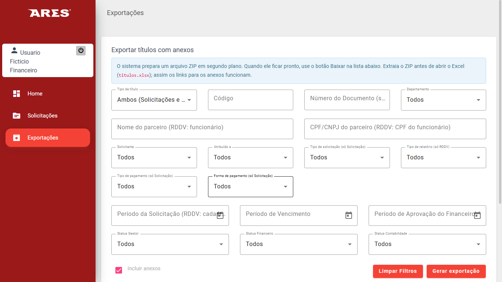
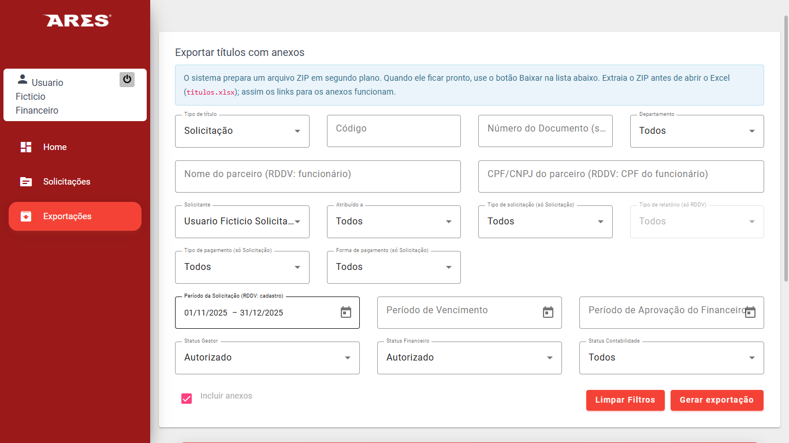
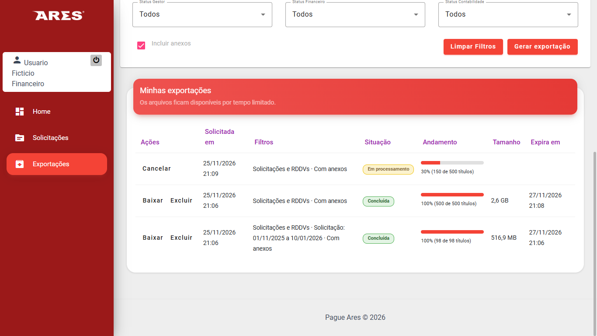
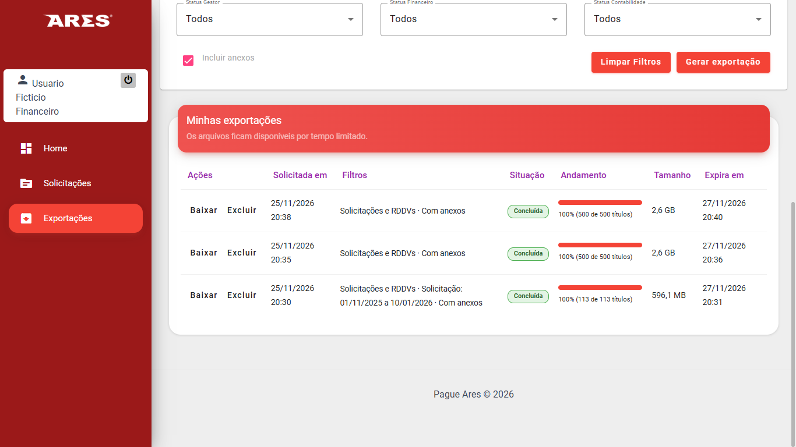
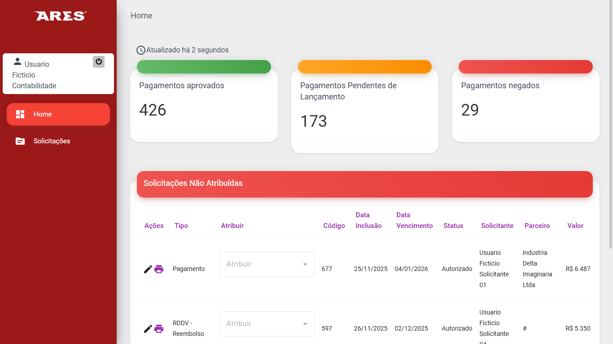
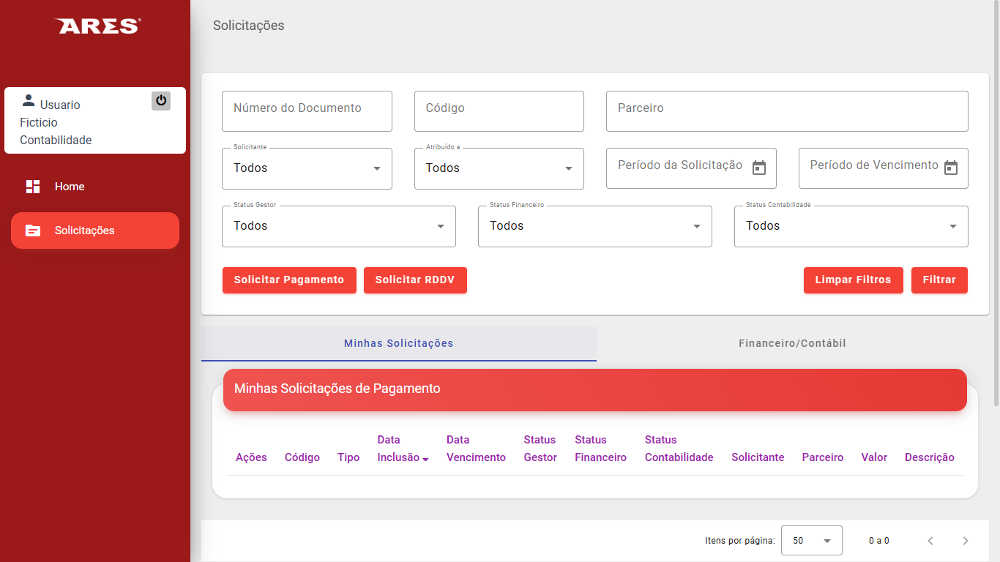
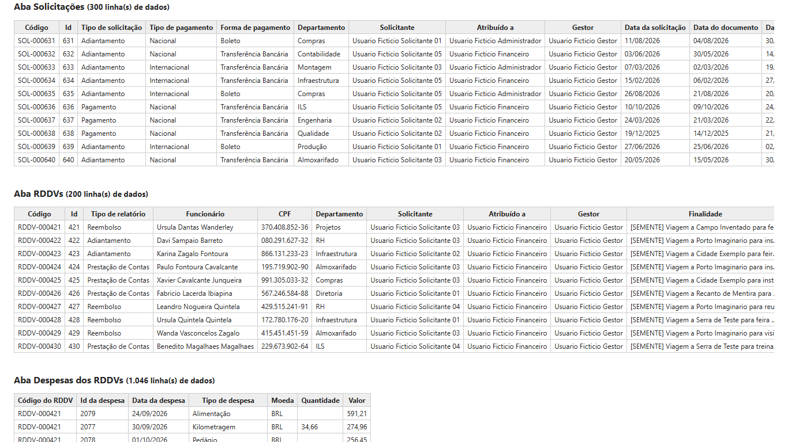
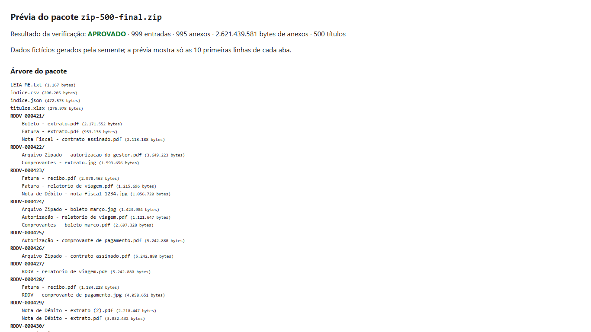
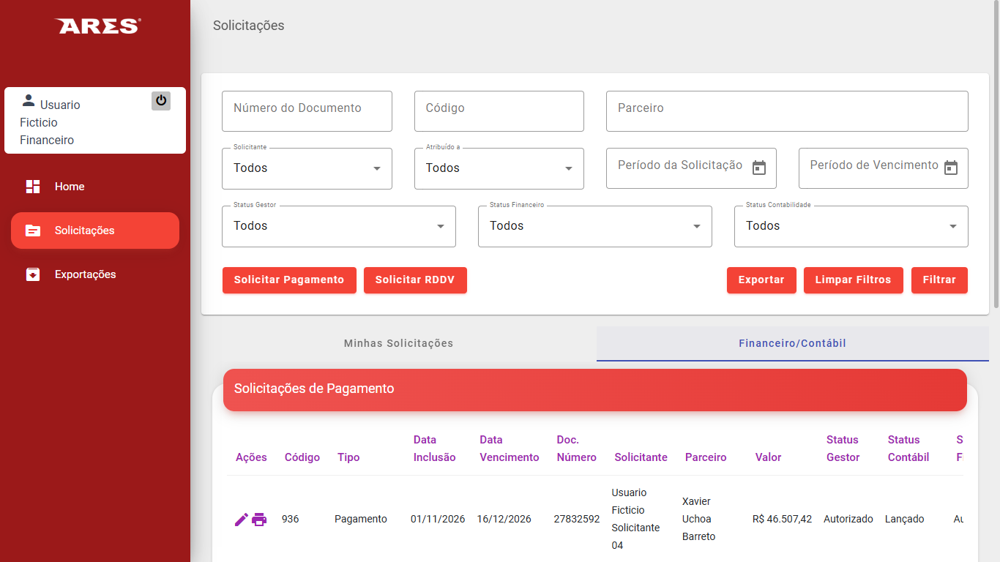

# Evidência técnica: exportação de títulos com anexos

Documento para o desenvolvedor responsável auditar o que foi feito. Cada afirmação aponta para o arquivo do repositório que a sustenta (saídas de teste, medições, relatórios do verificador, capturas). Onde um número não está em nenhum arquivo de dados, o documento diz isso em vez de estimar.

- Branch: `feature/exportacao-anexos`, ponta no commit `8f9bf57` (55 commits em relação à `main`, 39 sem contar os merges). Nada foi enviado ao remoto.
- Todos os dados são fictícios (semente em `tools/exportacao/`, e-mails `@exemplo.invalid`). Nenhum banco de produção foi acessado: os testes usam EF InMemory e a verificação ponta a ponta usou o SQL Server local do Docker.
- Nenhum segredo está gravado neste documento nem nos arquivos de dados.

## Índice

1. [Resumo do que mudou](#1-resumo-do-que-mudou)
2. [Decisões](#2-decisões)
3. [Segurança](#3-segurança)
4. [Concorrência](#4-concorrência)
5. [Revisões independentes](#5-revisões-independentes)
6. [Testes](#6-testes)
7. [Estrutura do pacote](#7-estrutura-do-pacote)
8. [Medições](#8-medições)
9. [Telas](#9-telas)
10. [Implantação](#10-implantação)
11. [Riscos e limitações](#11-riscos-e-limitações)

## 1. Resumo do que mudou

O Financeiro (papéis FIN e ADM, e só eles) escolhe filtros na tela **Exportações**, dispara a exportação e o servidor gera, em segundo plano, um pacote ZIP para download manual: `titulos.xlsx` (abas Solicitações, RDDVs, Despesas dos RDDVs e Anexos), uma pasta por título (`SOL-000123/`, `RDDV-000045/`) com os anexos renomeados pelo tipo de documento, e os índices `indice.csv` e `indice.json` com o SHA-256 de cada arquivo. Mudança total contra a `main`: 123 arquivos, +18.815 e -215 linhas (83 arquivos e +16.528 e -189 linhas em `back-end/`, `front-end/`, `tools/` e `docker-compose.yml`; o resto é documentação e evidência).

### Back-end (.NET 10)

| Peça | Arquivos principais |
|---|---|
| Tipos de domínio e contratos (códigos de título, filtros, DTOs, enums) | [`CodigoTitulo.cs`](../../back-end/Ares.PagueAres.Domain/Exportacao/CodigoTitulo.cs), [`FiltroExportacaoDto.cs`](../../back-end/Ares.PagueAres.Domain/Dtos/Exportacao/FiltroExportacaoDto.cs), [`ExportacaoJobDto.cs`](../../back-end/Ares.PagueAres.Domain/Dtos/Exportacao/ExportacaoJobDto.cs), `StatusExportacao`, `TipoTituloExportacao` |
| Tabela `ExportacaoJob` e migration `AdicionaExportacaoJob` (só cria tabela nova, com FK para `Usuario` sem cascata e dois índices) | [`ExportacaoJob.cs`](../../back-end/Ares.PagueAres.Infrastructure/Models/ExportacaoJob.cs), [`PagueAresContext.cs`](../../back-end/Ares.PagueAres.Infrastructure/PagueAresContext.cs), [script gerado](dados/migration-AdicionaExportacaoJob.sql) |
| Fonte de dados: escopo FIN/ADM, todos os filtros, rótulos | [`FonteExportacaoEf.cs`](../../back-end/Ares.PagueAres.Application/Exportacao/FonteExportacaoEf.cs), [`RotulosExportacao.cs`](../../back-end/Ares.PagueAres.Application/Exportacao/RotulosExportacao.cs) |
| Gerador do pacote: ZIP em streaming, Excel (ClosedXML), índices, nomes seguros, base64 em blocos | [`GeradorPacoteExportacao.cs`](../../back-end/Ares.PagueAres.Application/Exportacao/GeradorPacoteExportacao.cs), [`NomesPacote.cs`](../../back-end/Ares.PagueAres.Application/Exportacao/NomesPacote.cs), [`PlanilhaExportacao.cs`](../../back-end/Ares.PagueAres.Application/Exportacao/PlanilhaExportacao.cs), [`IndiceExportacao.cs`](../../back-end/Ares.PagueAres.Application/Exportacao/IndiceExportacao.cs), [`DecodificadorBase64.cs`](../../back-end/Ares.PagueAres.Application/Exportacao/DecodificadorBase64.cs) |
| Fila, worker e limpeza em segundo plano | [`ExportacaoFila.cs`](../../back-end/Ares.PagueAres.Application/Exportacao/ExportacaoFila.cs), [`ExportacaoWorker.cs`](../../back-end/Ares.PagueAres.Application/Exportacao/ExportacaoWorker.cs), [`ExportacaoLimpeza.cs`](../../back-end/Ares.PagueAres.Application/Exportacao/ExportacaoLimpeza.cs), [`MedidorEspacoLivre.cs`](../../back-end/Ares.PagueAres.Application/Exportacao/MedidorEspacoLivre.cs), [`ExportacaoSettings.cs`](../../back-end/Ares.PagueAres.Application/Configuration/ExportacaoSettings.cs) |
| API `api/exportacao` (criar, listar, obter, link de download, download, cancelar) e tokens de download | [`ExportacaoController.cs`](../../back-end/Ares.PagueAres.API/Controllers/ExportacaoController.cs), [`TokensDownloadExportacao.cs`](../../back-end/Ares.PagueAres.API/Services/TokensDownloadExportacao.cs) |
| Endurecimento dos endpoints legados (chave de exportação só para FIN/ADM, escopo pelo JWT, ZIPs por título, preview de anexo, sem `ex.Message` na resposta) | [`PreviewController.cs`](../../back-end/Ares.PagueAres.API/Controllers/PreviewController.cs), [`ExportController.cs`](../../back-end/Ares.PagueAres.API/Controllers/ExportController.cs), [`PreviewKeyDto.cs`](../../back-end/Ares.PagueAres.Domain/Dtos/Authentication/PreviewKeyDto.cs) |
| Excel legado da tela de pagamentos passou de FreeSpire.XLS para ClosedXML (pacote `FreeSpire.XLS` removido do `Ares.PagueAres.API.csproj`; `ClosedXML` 0.105.1 no `Ares.PagueAres.Application.csproj`) | `ExportController.cs`, [`ExportLegadoExcelTests.cs`](../../back-end/Ares.PagueAres.Tests.Integration/Controllers/ExportLegadoExcelTests.cs) |

### Front-end (Angular 20)

| Peça | Arquivos |
|---|---|
| Modelos, serviço e URLs | `front-end/src/app/models/exportacao/`, [`exportacao.service.ts`](../../front-end/src/app/services/exportacao.service.ts), `base-url.service.ts` |
| Guarda de papel e menu (item "Exportações" só para FIN e ADM) | [`papel.guard.ts`](../../front-end/src/app/guards/papel.guard.ts), `admin-layout.routing.ts`, `sidebar.component.ts` |
| Tela Exportações (filtros, lista com progresso, baixar, cancelar, excluir) | [`exportacoes.component.ts`](../../front-end/src/app/exportacoes/exportacoes.component.ts), `.html`, `.css` |
| Datas dd/MM/aaaa no app inteiro (correção do achado F5) | [`pt-br-date-adapter.ts`](../../front-end/src/app/core/date/pt-br-date-adapter.ts), registrado no `AdminLayoutModule` |
| Botão "Exportar" da tela de pagamentos mantido, só para FIN e ADM (confirmado pelo usuário) | `payments.component.ts` |

### Infraestrutura e ferramentas

- `Exportacao` em `appsettings.json` (11 chaves), volume nomeado `pagueares-exportacao` e `Exportacao__Pasta` no `docker-compose.yml`, `location = /api/exportacao/download` sem buffer em `front-end/nginx.conf` (download de GB passa pelo Nginx do compose em streaming).
- Guia de implantação no IIS: [`docs/implantacao/iis-exportacao.md`](../implantacao/iis-exportacao.md).
- Ferramentas de verificação em `tools/exportacao/` ([README](../../tools/exportacao/README.md)): [`semente.cs`](../../tools/exportacao/semente/semente.cs) (dados fictícios determinísticos no SQL local), [`verificar.cs`](../../tools/exportacao/verificar/verificar.cs) (confere o ZIP contra o contrato), [`medir.ts`](../../tools/exportacao/medir/medir.ts) (tempo e memória da API) e [`capturar.ts`](../../tools/exportacao/capturas/capturar.ts) (capturas de tela).
- `DOCUMENTACAO.md`, `back-end/CLAUDE.md` e `front-end/CLAUDE.md` atualizados (tela, API, ClosedXML no lugar de FreeSpire).

## 2. Decisões

Decisões fechadas com o usuário e decisões tomadas no plano, com o motivo de cada uma.

| Decisão | Motivo |
|---|---|
| **Quem exporta: só FIN e ADM.** Escopo fixo: `Rascunho == false`, `Cancelado == false` e `AprovadoGestor == true`, mais os filtros. CON, GES e SOL recebem 403. | Decisão fechada com o usuário. O Excel legado deixava ADM cair no ramo "só atribuídos a mim" e a chave de exportação saía para qualquer papel (ver [seção 3](#3-segurança)). |
| **Identidade sempre do JWT.** `userId` ou `idUsuario` no corpo ou na query são ignorados. | O Excel legado escolhia o escopo pelo `userId` da query (`[AllowAnonymous]`). Verificado em `Post_IdentidadeNoCorpoOuNaQuery_EIgnorada_JobGravadoComOIdDoJwt`. |
| **Fila em processo (`Channel<int>`) com o estado de cada exportação gravado na tabela `ExportacaoJob`.** Um job por vez. | Volume pequeno (25 títulos por dia útil, cerca de 5 MB por título, cerca de 2,5 GB por mês) não justifica broker externo. O estado no banco sobrevive à reciclagem do app pool: no início o worker marca como Falhou o que estava Processando e retoma os Pendente. A reivindicação do job usa a coluna `Versao` como token de concorrência (Pendente para Processando), então dois executores nunca geram o mesmo job. |
| **Token de download de uso único**, 32 bytes aleatórios em base64url, guardado em singleton com remoção atômica (`TryRemove`), validade de 120 s, emitido só ao dono de um job Concluído. | O arquivo é baixado por navegação do browser (sem cabeçalho `Authorization`), então o link precisa carregar a credencial; a validade curta e o uso único limitam o dano de um link vazado. Provado em `Download_TokenUsadoDuasVezes_200EDepois401` e `Download_DuasRequisicoesSimultaneasComOMesmoToken_ExatamenteUmaResponde200`. |
| **ZIP em disco com `System.IO.Compression`** (`ZipArchive` em modo `Create` sobre `FileStream`, `CompressionLevel.Fastest`, Zip64 automático), temporário `.parcial` renomeado para `.zip` ao concluir. | O pacote pode ter vários GB. Gerar em disco e servir com `PhysicalFile` (sem Range) mantém a memória da API baixa: [seção 8](#8-medições). Os anexos (base64 na coluna `Arquivo`) são lidos um a um, decodificados em blocos de 64 KiB e escritos direto na entrada do ZIP e no SHA-256. |
| **Um único processo de trabalho no IIS** (`Maximum Worker Processes = 1`, sem reciclagem sobreposta). | Fila e tokens de download ficam em memória: um segundo processo não os enxerga. Ver [implantação](../implantacao/iis-exportacao.md) e [riscos](#11-riscos-e-limitações). |
| **Pasta dos pacotes obrigatória fora de `Development`.** Sem `Exportacao:Pasta`, worker e limpeza não sobem e `POST api/exportacao` responde 503. | Achado 5 da revisão: instâncias diferentes na mesma pasta sobrescreveriam e apagariam pacotes umas das outras (os ids se repetem entre bancos). Refinado na F4 (só `Development` aceita pasta vazia). |
| **Nomes do pacote sanitizados e deduplicados** (`NomesPacote`): remove caracteres de controle e `< > : " / \ | ? *`, troca `..`, prefixa nomes reservados do Windows, limita a 120 caracteres, nunca começa com barra; duplicados viram `(2)`, `(3)` sem diferenciar caixa. | Nomes de anexo vêm do usuário; sem isso uma entrada `../../x` sobrescreveria arquivos de quem extrai o ZIP (zip-slip). |
| **Mensagens de erro fixas e amigáveis; exceção só no log.** | A resposta nunca deve expor texto de exceção (provado em `AfirmarErroAsync`, nos testes da E7, e nos casos de base64 inválido da E1). |
| **Sem trilha de histórico de aprovação**: a exportação lê os campos atuais (`DataAprovacao*`, `Observacao*`, `Status*`). | Escopo negativo do plano. |
| **Cabeçalho "Valor líquido do RDDV"** na aba RDDVs. | A view `vDespesasRddv` calcula saldo líquido (diárias vezes valor da diária mais despesas menos adiantamento menos saldo do cartão VTM), não a soma das despesas. Contrato, verificador e gerador foram alinhados. |
| **`indice.csv` protegido contra injeção de fórmula**: texto que começa com `=`, `+`, `-`, `@`, tab ou CR recebe o prefixo `'` (só no CSV). | Nomes de arquivo e tipos de documento são digitados pelo usuário e o Financeiro abre o CSV no Excel. |
| **Datas em dd/MM/aaaa no app inteiro** (adaptador de data pt-BR). | O seletor lia `01/11/2025` como 11 de janeiro (defeito pré-existente). Ver F5 na [seção 5](#5-revisões-independentes). |

## 3. Segurança

Método: nas etapas E1, E6 e E7 os testes foram escritos antes do código, executados e gravados em vermelho (commit `test:` só com os testes e o arquivo), e depois de novo em verde. Os arquivos de saída ficam em [`dados/tdd/`](dados/tdd/E1-vermelho.txt).

### 3.1 E1: endpoints legados (18 testes, 15 vermelhos e 3 controles)

Arquivo de teste: [`ExportLegadoSecurityTests.cs`](../../back-end/Ares.PagueAres.Tests.Integration/Controllers/ExportLegadoSecurityTests.cs). Saídas: [`E1-vermelho.txt`](dados/tdd/E1-vermelho.txt) e [`E1-verde.txt`](dados/tdd/E1-verde.txt). Comando: `dotnet test back-end/Ares.PagueAres.sln --filter "FullyQualifiedName~ExportLegadoSecurityTests"`.

| Cenário | Antes | Depois | Teste |
|---|---|---|---|
| CON pede chave de `Exportacao` | 200, chave emitida | 403, `Success=false`, "Exportação permitida apenas para os perfis Financeiro e Administrador." | `ChaveExportacao_PapelCON_Retorna403` |
| SOL pede chave de `Exportacao` | 200, chave emitida | 403, `Success=false` | `ChaveExportacao_PapelSOL_Retorna403` |
| ADM exporta o Excel: solicitação aprovada pelo gestor e atribuída a outro usuário | Excel sem linhas (ADM caía no ramo "só atribuídos a mim") | Excel traz a solicitação 300 e não traz rascunho, cancelado nem título sem aprovação do gestor | `ExportacaoExcel_ADM_IncluiSolicitacaoAprovadaNaoAtribuidaAEle` |
| Mesma chave de `Exportacao` usada duas vezes | 200 nas duas (chave reutilizável) | 200 e depois 401 | `ChaveExportacao_UsadaDuasVezes_SegundaRetorna401` |
| Chave do RDDV 53 em `export/rddv/attachment/54` | 200, ZIP entregue (validação com `&&`) | 401 | `ZipRddv_ChaveDeOutroRddv_Retorna401` |
| Chave da Solicitação 103 em `export/rddv/attachment/103` | 200, ZIP entregue | 401 | `ZipRddv_ChaveDeSolicitacaoComMesmoId_Retorna401` |
| Chave da Solicitação 103 em `export/request/attachment/104` | 200, ZIP entregue | 401 | `ZipSolicitacao_ChaveDeOutraSolicitacao_Retorna401` |
| Chave do RDDV 53 em `export/request/attachment/53` | 200, ZIP entregue | 401 | `ZipSolicitacao_ChaveDeRddvComMesmoId_Retorna401` |
| FIN pede chave de solicitação em rascunho de outro usuário (id 11, dono 3) | `Success=true` | `Success=false` | `ChaveSolicitacaoRascunho_FINDeOutroUsuario_Negada` |
| FIN pede chave de RDDV em rascunho de outro usuário (id 51, dono 3) | `Success=true` | `Success=false` | `ChaveRddvRascunho_FINDeOutroUsuario_Negada` |
| `sFilter` malformado no Excel | 400, mas o corpo trazia a mensagem do Newtonsoft ("Unexpected character encountered...") | 400 com "Filtro de exportação inválido." | `ExportacaoExcel_FiltroMalformado_Retorna400SemMensagemInterna` |
| Anexo com base64 inválido, nos ZIPs por título e nos dois previews (4 casos) | Corpo trazia a mensagem da `FormatException` ("The input is not a valid Base-64 string...") | 500 com "Não foi possível concluir a operação. Tente de novo."; a exceção vai só para o log | `AnexoBase64Invalido_RespostaSemMensagemInterna` (4 casos) |
| Controles do caminho legítimo (passam antes e depois) | passa | passa | `ZipRddv_ChaveCorreta_RetornaZip`, `ChaveSolicitacaoRascunho_Dono_Concedida`, `ChaveGerada_RespostaNaoExpoeIdUsuario` |

Verificação de vazamento na E1: `rg "ex\.Message" ExportController.cs PreviewController.cs` sem ocorrência ([`E1-verde.txt`](dados/tdd/E1-verde.txt)). Regressão da etapa: Integration 47 para 65 e Unit 20/20.

### 3.2 E7: API de exportação (63 testes, 62 vermelhos e 1 controle)

Arquivo de teste: [`ExportacaoControllerTests.cs`](../../back-end/Ares.PagueAres.Tests.Integration/Controllers/ExportacaoControllerTests.cs). Saídas: [`E7-vermelho.txt`](dados/tdd/E7-vermelho.txt) e [`E7-verde.txt`](dados/tdd/E7-verde.txt). Comando: `dotnet test back-end/Ares.PagueAres.sln --filter "FullyQualifiedName~ExportacaoControllerTests"`. Por ser código novo, "antes" é a ausência do controller: as 62 falhas do vermelho são todas "esperado o status X, recebido 404" (o projeto compila; nenhuma falha é de compilação). O valor dos testes está em quais ataques eles cobrem, e a mutação (abaixo) mostra que eles realmente os pegam.

| Cenário | Antes | Depois | Teste |
|---|---|---|---|
| Rotas autenticadas sem token (5 rotas) | 404 | 401 | `SemToken_RotaAutenticada_Responde401` |
| SOL, GES e CON em POST, GET lista, GET por id, link-download e DELETE (15 combinações; nada é alterado) | 404 | 403 | `PapelSemFinOuAdm_Responde403ENaoAlteraNada` |
| FIN e ADM criam exportação | 404 | 202 com job Pendente | `FinOuAdm_Post_Responde202ComJobPendente` |
| `idUsuario`/`userId` no corpo ou na query | 404 | ignorados; job gravado com o id do JWT | `Post_IdentidadeNoCorpoOuNaQuery_EIgnorada_JobGravadoComOIdDoJwt` |
| Lista do FIN não mostra jobs do ADM; só últimos 30 dias, mais recentes primeiro | 404 | só os do próprio usuário | `GetLista_SoOsJobsDoProprioUsuarioDosUltimos30Dias_MaisRecentesPrimeiro` |
| GET por id, link-download e DELETE de job de outro usuário (que também é ADM e FIN) | 404 | 404 e nada é alterado | `JobDeOutroUsuario_Responde404ENaoAlteraNada` |
| Link de download de job Pendente, Processando, Falhou ou Cancelado | 404 | 409 | `LinkDownload_DeJobNaoConcluido_Responde409` |
| Link de download de job Expirado, ou Concluído com prazo vencido ou arquivo ausente | 404 | 410 | `LinkDownload_DeJobExpirado_Responde410`, `LinkDownload_DeConcluidoComPrazoVencidoOuSemArquivo_Responde410` |
| Token de download: 32 bytes e validade configurada | 404 | emitido ao dono | `LinkDownload_DeConcluido_DevolveTokenDe32BytesComValidadeConfigurada` |
| Download sem token ou com token vazio | 404 | 401 | `Download_SemToken_Responde401` |
| Download com token inventado ou tentativa de caminho relativo | 404 | 401 | `Download_TokenInventado_Responde401` |
| Token usado duas vezes | 404 | 200 e depois 401 | `Download_TokenUsadoDuasVezes_200EDepois401` |
| Duas requisições simultâneas com o mesmo token (10 rodadas) | 404 | exatamente uma responde 200 | `Download_DuasRequisicoesSimultaneasComOMesmoToken_ExatamenteUmaResponde200` |
| Token vencido (validade 1 s, espera 1,5 s) | 404 | 401 | `ComLimitesCurtos.Download_TokenVencido_Responde401` |
| Download válido: `application/zip`, `Content-Disposition` com o nome do contrato, corpo igual ao arquivo, sem `Accept-Ranges` | 404 | 200 | `Download_TokenValido_Responde200EmZipComNomeDoContratoECorpoIgualAoArquivo` |
| Download depois de o job expirar | 404 | 410 | `Download_JobExpiradoDepoisDoLink_Responde410` |
| Terceiro job ativo do mesmo usuário | 404 | 429 | `Post_TerceiroJobAtivoDoMesmoUsuario_Responde429` |
| Fim antes do início (3 períodos), filtro sem títulos, mais títulos que o limite | 404 | 400 | `Post_FiltroComFimAntesDoInicio_Responde400`, `Post_FiltroSemTitulos_Responde400`, `ComLimitesCurtos.Post_MaisTitulosQueOLimite_Responde400` |
| Corpo inválido (vazio, JSON quebrado, número inválido, enum fora da faixa ou inexistente) sem texto de exceção | 404 | 400 com envelope `success=false`, sem "Exception", pilha, `System.`, `Ares.PagueAres` nem trecho do serializador | `Post_CorpoInvalido_Responde400SemTextoDeExcecao` |
| DELETE de Pendente, Processando, Concluído | 404 | 204 (Cancelado; pede cancelamento; apaga o arquivo e vira Expirado) | `Delete_DePendente_...`, `Delete_DeProcessando_...`, `Delete_DeConcluido_Responde204ApagaOArquivoEExpira` |
| DELETE de Falhou, Expirado ou Cancelado | 404 | 409 | `Delete_DeJobJaEncerrado_Responde409` |
| Controle: a fábrica com `WorkerHabilitado=false` não sobe worker nem limpeza | passa | passa | `Fabrica_ComWorkerDesligado_NaoSobeWorkerNemLimpeza` |

Resultado verde: 63/63 em 4 execuções seguidas. Mutação temporária (desfeita, não commitada): sem a checagem de papel FIN/ADM, sem o filtro de dono nas consultas por id e com o token lido por `TryGetValue` em vez de `TryRemove`, **20 testes falham** (os 15 de `PapelSemFinOuAdm`, os 3 de `JobDeOutroUsuario`, `Download_TokenUsadoDuasVezes_200EDepois401` e `Download_DuasRequisicoesSimultaneasComOMesmoToken_ExatamenteUmaResponde200`), o que mostra que os testes detectam a remoção de cada controle.

### 3.3 Mesmos controles contra a stack real

Verificados no Docker local com os usuários fictícios da semente (ADM, FIN, CON, GES e SOL), em [`e2e.md`](dados/e2e.md) seção 7 e repetidos nas seções 9.4 e 10: `POST api/exportacao` sem token 401, como CON 403, como SOL 403; `GET api/exportacao` e `GET api/exportacao/{id}` como CON 403; job do FIN visto pelo ADM 404 (id e link-download); chave de preview de Exportação 403 para CON, SOL e GES e 200 para FIN e ADM; download pelo front (Nginx) 200 `application/zip` com `Content-Disposition: attachment`, segundo download com o mesmo token 401, terceiro direto na API 401, download sem token 401.

As correções F1 (preview de anexo de outro título e zip-slip nos ZIPs legados) também foram exercitadas contra a API real: [seção 5](#5-revisões-independentes) e `e2e.md` seção 9.4.

## 4. Concorrência

Cenários da E6, em [`ExportacaoWorkerTests.cs`](../../back-end/Ares.PagueAres.Tests.Integration/Exportacao/ExportacaoWorkerTests.cs), com banco EF InMemory compartilhado entre "processos" (mesma `InMemoryDatabaseRoot`) e gerador falso controlado por `TaskCompletionSource`. Saídas: [`E6-vermelho.txt`](dados/tdd/E6-vermelho.txt) e [`E6-verde.txt`](dados/tdd/E6-verde.txt). Comando: `dotnet test back-end/Ares.PagueAres.sln --filter "FullyQualifiedName~ExportacaoWorker"`. O vermelho da E6 é a ausência dos tipos (`ExportacaoFila`, `ExportacaoWorker`, `ExportacaoLimpeza`): o projeto de testes não compila e os 17 casos não chegam a rodar; a prova de que os testes pegam a falha certa está nas mutações, mais abaixo.

| Cenário | O que o teste prova |
|---|---|
| 1. `DoisJobsNaFila_GeradorNuncaRodaDoisAoMesmoTempo_EAmbosConcluem` | O segundo job só começa depois de o primeiro ser liberado: concorrência máxima do gerador 1, os dois Concluídos. |
| 2. `DoisWorkersNoMesmoBanco_JobPendenteEGeradoExatamenteUmaVez` | Dois workers (dois `ServiceProvider`) no mesmo banco, 8 jobs enfileirados nos dois: cada job é gerado exatamente uma vez (reivindicação pelo token `Versao`). |
| 3. `Inicio_ProcessandoViraFalhou_ParciaisApagados_PendentesProcessadosPorDataDeCriacao` | No início, Processando vira Falhou com "A exportação foi interrompida por um reinício do servidor. Gere a exportação de novo.", todo `.parcial` é apagado e os Pendente são retomados na ordem de `DataCriacao`. |
| 4. `CancelamentoDePendente_ViraCanceladoSemChamarOGerador` | Pendente cancelado pela API ou com `CancelamentoSolicitado` no banco não chega ao gerador. |
| 4. `CancelamentoEmProcessando_PelaFila_ViraCanceladoEApagaParcial` | `ExportacaoFila.SolicitarCancelamento` interrompe a geração na hora; Cancelado, sem `.parcial` e sem `.zip`. |
| 4. `CancelamentoEmProcessando_SoPeloBanco_ViraCanceladoEApagaParcial` | Pedido gravado só no banco (outro processo): o acompanhamento de progresso percebe em até 2 s. |
| 5. `ParadaDoHostDuranteAGeracao_ViraFalhouComMensagemDeInterrupcao` | `StopAsync` no meio da geração: Falhou com a mensagem de interrupção, sem `.parcial`. |
| 6. `ExportacaoException_ViraFalhouComAMensagemDela` e `ExcecaoGenerica_ViraFalhouComMensagemGenericaSemOTextoDaExcecao` | Falha prevista usa a mensagem dela; qualquer outra vira "Não foi possível gerar a exportação..." sem trecho do texto da exceção. |
| 7. `EspacoLivreAbaixoDoMinimo_ViraFalhouComMensagemAmigavelSemChamarOGerador` | Sem espaço, o gerador nem roda. |
| 8. `Limpeza_ExpiraConcluidoVencido_ApagaOrfaoVelho_MantemArquivoDeJobValido` | Concluído vencido vira Expirado e o arquivo é apagado; órfão velho é apagado; órfão recente, arquivo de job válido e arquivos fora do padrão `exportacao-*.zip` ficam. |
| 9. `Sucesso_ArquivoFinalSemParcial_TamanhoEExpiracaoGravados` | `.zip` existe e `.parcial` não; `TamanhoBytes` igual ao arquivo; `DataExpiracao` igual a conclusão mais retenção. |
| Complementares | `Progresso_EGravadoDuranteAGeracao`, registro no DI com `WorkerHabilitado` verdadeiro e falso, pasta própria da fábrica de testes. |

Resultado verde da E6: 17/17 em 3 execuções seguidas. **Conferência por mutação** (alterações temporárias, desfeitas antes do commit): aceitar um job já Processando e seguir depois de `DbUpdateConcurrencyException` faz `DoisWorkersNoMesmoBanco_...` falhar (job gerado pelos dois executores); disparar os jobs sem esperar e remover o semáforo de um job por vez faz `DoisJobsNaFila_...` falhar.

Outros pontos de concorrência cobertos fora da E6:

- Token de download com remoção atômica: `Download_DuasRequisicoesSimultaneasComOMesmoToken_ExatamenteUmaResponde200` (seção 3.2).
- Token `Versao` na entidade: [`ExportacaoJobModeloTests.cs`](../../back-end/Ares.PagueAres.Tests.Integration/Exportacao/ExportacaoJobModeloTests.cs) (duas instâncias de contexto alteram o mesmo job; a segunda `SaveChanges` lança `DbUpdateConcurrencyException`).
- Achados da revisão sobre job preso em Processando, sinal de vida, reconciliação e espaço em disco (F2 e F4): [seção 5](#5-revisões-independentes), saídas [`F2-*.txt`](dados/tdd/F2-vermelho.txt) e [`F4-*.txt`](dados/tdd/F4-vermelho.txt).
- Recuperação depois de reinício, na stack real: `e2e.md` seções 6 e 9.3. Exportação cheia (500 títulos) criada, `docker restart pagueares-api` com 10/500 títulos processados: em cerca de 9 s o job aparece Falhou com a mensagem de reinício, a pasta do volume só tem os pacotes concluídos (nenhum `.parcial`) e uma nova exportação conclui.

## 5. Revisões independentes

Três rodadas de revisão independente (revisor de risco alto) mais os achados da fase de capturas. Cada achado foi corrigido com teste: vermelho antes, verde depois, saída em [`dados/tdd/`](dados/tdd/F1-vermelho.txt).

### 5.1 Primeira revisão: aprovado com ressalvas, 7 achados (1 alto, 2 médios, 4 baixos)

Dois achados (1 e 3) eram **pré-existentes** nos endpoints legados e ampliaram o escopo da E1, aceitos por estarem nos mesmos arquivos e no mesmo tema de segurança. Correções agrupadas em F1 (back, segurança), F2 (back, worker) e F3 (front).

### 5.2 Reconferência do mecanismo de concorrência da F2: aprovado com ressalvas, 4 baixos e 1 pergunta, todos aceitos (F4)

O revisor reconferiu o mecanismo de reconciliação e de sinal de vida criado na F2. Os 4 achados baixos (configuração fora da faixa, teste da guarda de job em execução, pacote apagado com resultado desconhecido, falha ao encerrar órfão) e a pergunta sobre a pasta vazia viraram a F4, com testes vermelhos primeiro (`70a1f7f`) e correção depois (`a29dcf6`).

### 5.3 Achados da fase de capturas (F5 e F6)

Ao gerar as capturas de tela apareceram dois problemas. **F5**: o seletor de data lia `dd/MM` como `MM/dd` no app inteiro (defeito pré-existente, usava `MatNativeDateModule` sem locale) e o botão "Limpar Filtros" da tela Exportações deixava texto de data no campo. **F6**: a semente gerava CPF e CNPJ com dígito verificador válido ao acaso, o que poderia coincidir com documentos reais e aparece nas capturas. Depois das correções a stack foi reconstruída, a semente recriada e as capturas regeneradas ([`e2e.md`](dados/e2e.md) seção 10).

### 5.4 Tabela achado, severidade, correção, teste, antes e depois

| Achado | Severidade | Correção | Teste | Antes (vermelho) | Depois (verde) |
|---|---|---|---|---|---|
| **1** Preview de anexo não conferia o título da chave (usuário com chave do próprio título lia anexo de rascunho de outro). Pré-existente | Alto | **F1**: `PreviewController` busca o anexo pelo id do anexo **e** pelo título da rota (`IdDocumentoSolicitacao == attachmentId && IdSolicitacao == id`, idem RDDV); anexo de outro título cai no mesmo 404 do inexistente | `PreviewAnexo_ChaveDoTituloComAnexoDeOutroTitulo_Retorna404` (Solicitação e RDDV) | 200, anexo do rascunho de outro usuário entregue | 404, mesmo corpo do anexo inexistente. [F1-vermelho](dados/tdd/F1-vermelho.txt), [F1-verde](dados/tdd/F1-verde.txt) |
| **3** Zip-slip nos ZIPs legados por título (nomes `..\..\fora.pdf`, `C:\Windows\...`, `/x`, duplicados em outra caixa). Pré-existente | Médio | **F1**: `ExportController` passa cada nome por `NomesPacote.Sanitizar` e a lista por `NomesPacote.Deduplicar`; nome vazio vira `anexo-<id>` | `ZipAnexos_NomeComCaminho_EntradaNaoSaiDaPastaDeExtracao` e `ZipAnexos_AnexosComMesmoNome_EntradasDistintas` (Solicitação e RDDV) | Entradas `../../fora.pdf` e `../../fora2.pdf`; `BOLETO.PDF` repetido sem diferenciar caixa | 7 entradas sem `..`, `\` nem `:`, todas distintas; `boleto.pdf` inalterado |
| **2** Job preso em Processando quando a gravação do estado final falha | Médio | **F2**: gravação do estado final repetida até 5 vezes com espera crescente; reconciliação periódica encerra órfão sem executor, reenfileira Pendente fora da fila; sinal de vida do executor | `GravacaoDaConclusaoFalhaNasPrimeirasTentativas_RepeteEGravaConcluido`, `GravacaoDaFalhaFalhaNasPrimeirasTentativas_RepeteEGravaFalhou`, `ProcessandoSemExecutor_ViraFalhouNaReconciliacao_...`, `PendenteForaDaFila_EReenfileiradoPelaReconciliacaoEProcessado`, `ReivindicacaoFalha_PendenteVoltaAFilaPelaReconciliacao` (+ controles `JobEmExecucaoNesteProcesso_...` e `JobEmExecucaoEmOutroProcessoComSinalDeVida_...`) | 5 falhas: job continua Processando ou Pendente (esperado Concluído, Falhou ou reprocessado) | 29/29 em 3 execuções. [F2-vermelho](dados/tdd/F2-vermelho.txt), [F2-verde](dados/tdd/F2-verde.txt) |
| **5** Pasta de pacotes compartilhada entre instâncias (com `Pasta` vazio o worker subia em `%TEMP%`) | Baixo | **F2**: fora de `Development` sem `Pasta`, worker e limpeza não sobem e a API responde 503 | `PastaVaziaForaDeDesenvolvimento_WorkerELimpezaNaoSobem_EJobFicaPendente`, `PastaVaziaForaDeDesenvolvimento_ApiRecusaNovaExportacaoCom503` | Worker subia; POST respondia 202 | `ExecuteTask` nulo; 503 sem criar job |
| **6** Espaço em disco só conferido no início | Baixo | **F2**: conferido de novo a cada 2 s durante a geração; `IOException` de disco cheio vira a mensagem de espaço | `EspacoCaiAbaixoDoMinimoDuranteAGeracao_ViraFalhouComMensagemDeEspacoEApagaParcial`, `DiscoCheioDuranteAGeracao_ViraFalhouComMensagemDeEspaco` (controle `EspacoNaoMensuravel_GeracaoSegueEConclui`) | Job continuava Processando com o espaço em 100 MB; disco cheio virava a mensagem genérica | Falhou com a mensagem de espaço, sem `.parcial` nem `.zip` |
| **4** Polling continuava depois de `ngOnDestroy` | Baixo | **F3**: resposta que chega depois da destruição da tela não recarrega a lista nem liga o polling | `resposta de listar() que chega depois do ngOnDestroy com job Pendente nao liga o polling`, `criar() que responde depois do ngOnDestroy nao recarrega a lista nem liga o polling` | 5 specs falham (`Expected spy ExportacaoService.listar not to have been called`, `Expected true to be false`) | Karma 120/120. [F3-vermelho](dados/tdd/F3-vermelho.txt), [F3-verde](dados/tdd/F3-verde.txt) |
| **7** Falha de download trocava a tela pelo JSON do erro | Baixo | **F3**: baixa por iframe oculto, sem navegar nem abrir janela; token recusado mostra aviso para gerar o link de novo | `Baixar cria um iframe oculto com a URL do token, sem navegar nem abrir janela`, `se o servidor devolve um documento (token recusado), o usuario e orientado a gerar o link de novo`, `um novo Baixar descarta o iframe anterior` | `Expected 0 to be 2`, `Expected spy navegarPara not to have been called` | Passam; também confirmado no Edge real (`e2e.md` 9.5) |
| **F4-1** Configuração da reconciliação fora da faixa (`Task.Delay`/`TimeSpan` com valor enorme ou NaN) | Baixo | **F4**: intervalo limitado a 1 a 3600 s e limite sem sinal de vida a 10 a 86400 s, lidos uma vez; fora da faixa vira o extremo (NaN vira o padrão) com aviso no log | `ConfiguracaoDaReconciliacaoForaDaFaixa_WorkerProcessaNormalmente_EParaRapido` (3 casos) | Job fica Pendente ou Processando (laço girando sem pausa) | Conclui; `StopAsync` em menos de 5 s |
| **F4-2** Faltava teste que provasse a guarda "job em execução neste processo" | Baixo | **F4**: teste reescrito (gravações sem mudança de status falham, `Versao` parada por 1,5 vez o limite) | `JobEmExecucaoNesteProcesso_NaoEReconciliadoMesmoPassandoOLimite` | Passava antes sem provar a guarda; com a guarda removida (mutação) falha: "Expected Status(job) to be Processando ... but found Falhou" | Passa com as guardas; falha sem elas (mutação refeita no código final) |
| **F4-3** Pacote apagado quando o resultado da gravação da conclusão é desconhecido (banco com Concluído e `.zip` apagado: download daria 410) | Baixo | **F4**: `GravarEstadoFinalAsync` devolve Gravada, Recusada ou Desconhecida; só apaga o pacote se recusada ou cancelada; a recuperação do início apaga o `.zip` do job que marca Falhou | `GravacaoDaConclusaoSemRespostaEmTodasAsTentativas_ComConcluidoNoBanco_MantemOPacote`, `Inicio_ProcessandoComPacoteJaPublicado_ViraFalhouEApagaOPacote` (controle `ConclusaoRecusadaPorqueOJobDeixouDeEstarProcessando_ApagaOPacote`) | `File.Exists(Final(id))` falso; pacote do job encerrado no início continuava na pasta | Pacote mantido; pacote do job Falhou no início apagado |
| **F4-4** Falha ao encerrar um órfão recomeçava a contagem e interrompia a volta | Baixo | **F4**: a observação só sai depois do encerramento bem-sucedido; exceção capturada por job | `EncerramentoDeOrfaoFalhaUmaVez_RepeteNaVoltaSeguinteSemEsperarOLimite_EOutroOrfaoDaMesmaVoltaEEncerrado` | Outro órfão só era encerrado 1 s tarde demais e o que falhou esperava de novo o limite (conclusão às 23:40:27 contra o esperado até 23:40:20) | Outro órfão até 1 s depois da falha; o que falhou, até 5 s |
| **F4-5** (pergunta aceita) `Pasta` vazia aceita também em `Test` | Baixo | **F4**: `PastaObrigatoriaAusente` = `Pasta` vazia e ambiente diferente de `Development`; guia IIS atualizado | `PastaVaziaForaDeDesenvolvimento_WorkerELimpezaNaoSobem_EJobFicaPendente(ambiente: "Test")`, `PastaObrigatoriaAusente_SoDevelopmentAceitaPastaVazia` (6 casos) | Worker subia em `Test`; `PastaObrigatoriaAusente` falso | Todos passam. [F4-vermelho](dados/tdd/F4-vermelho.txt), [F4-verde](dados/tdd/F4-verde.txt): 43/43 em 3 execuções |
| **F5-1** Datas digitadas em dd/MM/aaaa lidas como MM/dd no app inteiro (`01/11/2025` virava 11 de janeiro; `31/12/2025` ficava inválida). Pré-existente: afeta exportações, pagamentos, nova solicitação e novo RDDV | Não registrada nos arquivos de dados | **F5**: `PtBrDateAdapter` (parse dd/MM/aaaa com d/M/aaaa aceito, data inexistente inválida, format dd/MM/aaaa, locale pt-BR), registrado no `AdminLayoutModule` | Specs de `PtBrDateAdapter` (parse, format, datas inválidas, bissexto, ligação no `AdminLayoutModule`) e de `ExportacoesComponent` (digitar `01/11/2025` vale 1º de novembro; filtro `2025-11-01`) | Karma 14 FAILED de 138: `Expected 0 to be 10`, `Expected NaN to be 2025`, `Expected '2025-01-11' to be '2025-11-01'` | 138/138. [F5-vermelho](dados/tdd/F5-vermelho.txt), [F5-verde](dados/tdd/F5-verde.txt); no Edge real, `01/11/2025` a `31/12/2025` chegam à API como `2025-11-01` e `2025-12-31` (`e2e.md` 10.3) |
| **F5-2** "Limpar Filtros" da tela Exportações deixava o texto das datas no campo | Não registrada nos arquivos de dados | **F5**: esvazia também o texto dos campos de data e recalcula a validade | `Limpar Filtros esvazia os campos de data na tela e o filtro montado nao traz datas`, `Limpar Filtros tambem esvazia texto de data ainda invalido (que nao chegou ao modelo)` | `Expected '31/12/2025' to be ''`, `Expected '31/02/2025' to be ''` | Passam; no Edge real os 6 campos ficam vazios, inclusive com `31/02/2025` digitado |
| **F6** Semente gerava CPF e CNPJ com dígito verificador válido ao acaso (podiam coincidir com documentos reais e aparecem nas capturas) | Não registrada nos arquivos de dados | **F6** (`semente.cs`): dígitos verificadores propositalmente errados; opção `--autoteste` | Sem teste vermelho/verde em `dados/tdd/` (ferramenta, não código de produção). Evidência: `semente --autoteste` (10.000 CPFs e 10.000 CNPJs, nenhum válido) e conferência na semente real: 0 de 525 documentos passam no dígito verificador, validador conferido contra um CPF e um CNPJ válidos conhecidos | A prévia antiga tinha CPFs com dígito verificador válido | 0 de 525 válidos (`e2e.md` 10.2); prévia e capturas regeneradas |

Observações:

- A numeração 1 a 7 é a da primeira revisão (achados 1 e 3 na F1, 2, 5 e 6 na F2, 4 e 7 na F3). A reconferência (F4-1 a F4-5) tem numeração própria. As severidades dos achados 1 a 7 e F4 são as dos registros da revisão; as da F5 e da F6 não estão nos arquivos de dados e não foram inventadas.
- A F4 também corrigiu a pergunta 5 junto com a revisão do achado 1; ela entra como "pergunta aceita", não como achado.
- Depois de cada rodada de correções, a verificação ponta a ponta foi repetida com o código integrado: `e2e.md` seções 9 (após F1 a F3) e 10 (código final).
- O achado de dado corrompido do banco local na seção 9.2 do `e2e.md` está em [riscos](#11-riscos-e-limitações).

## 6. Testes

Fontes: [`suites.md`](dados/suites.md) (execução integrada da E13, no commit `cd21a73`), os arquivos `tdd/*-verde.txt` das correções posteriores e [`e2e.md`](dados/e2e.md). O back-end não mudou depois do commit `a29dcf6` (F4); depois dele só mudaram front-end, ferramentas e evidência.

### 6.1 Comandos

```powershell
# Build do back-end
dotnet build back-end/Ares.PagueAres.sln -c Debug      # 0 erros
dotnet build back-end/Ares.PagueAres.sln -c Release    # 0 erros (35 avisos, de nulabilidade e código legado)

# Testes do back-end (xUnit)
dotnet test back-end/Ares.PagueAres.sln

# Subconjuntos citados neste documento
dotnet test back-end/Ares.PagueAres.sln --filter "FullyQualifiedName~ExportLegadoSecurityTests"
dotnet test back-end/Ares.PagueAres.sln --filter "FullyQualifiedName~ExportacaoControllerTests"
dotnet test back-end/Ares.PagueAres.sln --filter "FullyQualifiedName~ExportacaoWorker"

# Front-end (em front-end/, com o Edge no lugar do Chrome)
$env:CHROME_BIN = (Get-Command msedge -ErrorAction SilentlyContinue).Source ?? 'C:\Program Files (x86)\Microsoft\Edge\Application\msedge.exe'
npx ng test --watch=false --browsers=ChromeHeadless
npx ng build
```

### 6.2 Totais finais

| Suíte | Resultado | Fonte |
|---|---|---|
| Back-end Unit (`Ares.PagueAres.Tests.Unit`) | **131/131** | [`F4-verde.txt`](dados/tdd/F4-verde.txt) |
| Back-end Integration (`Ares.PagueAres.Tests.Integration`) | **254/254** | [`F4-verde.txt`](dados/tdd/F4-verde.txt) |
| Front-end Karma (Edge headless) | **138/138**, 0 falhas | [`F5-verde.txt`](dados/tdd/F5-verde.txt) |
| `dotnet build` Debug | 0 erros | `F4-verde.txt` |
| `ng build` | sem erros | `F5-verde.txt` |

Evolução da suíte de integração ao longo das etapas (cada valor vem do arquivo indicado): 47 antes da E1, 65 depois da E1 ([`E1-verde.txt`](dados/tdd/E1-verde.txt)); 151 depois da E6 ([`E6-verde.txt`](dados/tdd/E6-verde.txt)); 220 na verificação integrada E13 ([`suites.md`](dados/suites.md): 220 Integration e 131 Unit, 351 no total, e Karma 115/115 naquele momento); 228 depois da F1; 232 depois da F2; 254 depois da F4.

Observações:

- Os testes do worker dependem de tempo (esperas de reconciliação e de sinal de vida): a classe `ExportacaoWorkerTests` leva cerca de 1,5 minuto (1,47 a 1,54 min nas três execuções da F4). Rode em segundo plano.
- Buscas de código registradas em `suites.md` seção 6: `rg "Spire" back-end` sem ocorrência; `rg "ex\.Message"` nos controllers: 24 ocorrências, todas em controllers legados fora da exportação (ver [riscos](#11-riscos-e-limitações)).
- Aviso do Karma: mensagens `NG0304` de `mat-form-field` e `mat-label` no `RefundsComponent` (componente que já existia) são avisos de console, não falhas.
- Esses totais foram transcritos dos arquivos de dados acima; este documento não reexecutou as suítes.

## 7. Estrutura do pacote

### 7.1 Árvore

```
exportacao-titulos-<id>-<yyyyMMdd-HHmm>.zip
├── LEIA-ME.txt        extraia o ZIP antes de abrir o Excel; descrição dos arquivos; data de geração; filtros usados
├── titulos.xlsx       abas: Solicitações, RDDVs, Despesas dos RDDVs, Anexos
├── indice.csv         UTF-8 com BOM, separador ";" , uma linha por anexo
├── indice.json        UTF-8 sem BOM, camelCase, indentado: filtros, totais, títulos e arquivos
├── SOL-000123/
│   └── Nota Fiscal - boleto.pdf
└── RDDV-000045/
    └── Comprovante - recibo.jpg
```

Ordem de escrita no ZIP: anexos primeiro (com tamanho e SHA-256 calculados no streaming), depois `titulos.xlsx`, `indice.csv`, `indice.json` e `LEIA-ME.txt`. Só títulos com ao menos um anexo ganham pasta. Nome de cada anexo: `<tipo de documento> - <nome original sanitizado>`. Um recorte real, com os 4 arquivos da raiz e as primeiras pastas, está em [`previa-pacote.html`](dados/previa-pacote.html) e na [captura 08](img/08-arvore-pacote.png).

Do pacote de 500 títulos gerado com o código final (relatório em [`verificacao-500-codigo-final.json`](dados/verificacao-500-codigo-final.json)): 999 entradas (995 anexos e as 4 da raiz), 500 pastas, 300 linhas de Solicitações, 200 de RDDVs, 1.046 de Despesas dos RDDVs e 995 de Anexos.

### 7.2 Amostra do `indice.csv`

Primeiras linhas de [`amostra-pacote.txt`](dados/amostra-pacote.txt) (pacote de 500 títulos da verificação E14; o arquivo é histórico e a semente foi recriada depois, então os valores do pacote final diferem). A terceira linha mostra um nome malicioso da semente (`C:\Windows\x.exe`) já sanitizado:

```
titulo;tipo_titulo;tipo_documento;nome_original;arquivo;caminho_relativo;tamanho_bytes;sha256
RDDV-000001;Rddv;Boleto;ordem de compra.jpg;Boleto - ordem de compra.jpg;RDDV-000001/Boleto - ordem de compra.jpg;1457677;f6d844c12545448189aef786f573e5bf0601f53bfcbaee055e9475c46ca2ea7c
RDDV-000001;Rddv;Comprovantes;contrato assinado.jpg;Comprovantes - contrato assinado.jpg;RDDV-000001/Comprovantes - contrato assinado.jpg;1588910;b4ae3c815047aa025ba8604bf30c0d5c598a55667a6c08d2d59c926e9dde047c
RDDV-000001;Rddv;Outros Documentos;C:\Windows\x.exe;Outros Documentos - CWindowsx.exe;RDDV-000001/Outros Documentos - CWindowsx.exe;2196292;19981dadeab74f7d3992d26fb8117bd6936641b08fdee075d68075a0089e1e04
```

### 7.3 Formato do `indice.json`

Não há um `indice.json` real versionado (o ZIP de 500 títulos não foi guardado). O formato abaixo vem do código ([`IndiceExportacao.cs`](../../back-end/Ares.PagueAres.Application/Exportacao/IndiceExportacao.cs)); os valores são ilustrativos: a primeira entrada reaproveita a primeira linha do CSV acima e os totais são os do relatório do verificador do pacote final (`resumo` de `verificacao-500-codigo-final.json`). `geradoEm`, `exportacaoId` e `filtros` são exemplos de forma.

```json
{
  "versao": 1,
  "exportacaoId": 42,
  "geradoEm": "2026-11-25T21:08:00-03:00",
  "filtros": { "tipoTitulo": 0, "incluirAnexos": true },
  "totais": { "solicitacoes": 300, "rddvs": 200, "despesas": 1046, "anexos": 995, "bytesAnexos": 2621439581 },
  "titulos": [
    { "codigo": "RDDV-000001", "tipo": "Rddv", "id": 1, "pasta": "RDDV-000001/", "quantidadeAnexos": 3 }
  ],
  "arquivos": [
    {
      "titulo": "RDDV-000001",
      "tipoTitulo": "Rddv",
      "tipoDocumento": "Boleto",
      "nomeOriginal": "ordem de compra.jpg",
      "arquivo": "Boleto - ordem de compra.jpg",
      "caminhoRelativo": "RDDV-000001/Boleto - ordem de compra.jpg",
      "tamanhoBytes": 1457677,
      "sha256": "f6d844c12545448189aef786f573e5bf0601f53bfcbaee055e9475c46ca2ea7c"
    }
  ]
}
```

(`filtros` real serializa todos os campos de `FiltroExportacaoDto`, e `titulos` lista todos os títulos, inclusive os sem anexo, com `pasta: null`.)

### 7.4 Como conferir um hash

O `sha256` do índice é hexadecimal em minúsculas; `Get-FileHash` devolve maiúsculas, então a comparação abaixo converte. Rode em `pwsh -NoProfile`, dentro da pasta onde o ZIP foi extraído.

Um arquivo:

```powershell
(Get-FileHash -Algorithm SHA256 -LiteralPath 'RDDV-000001/Boleto - ordem de compra.jpg').Hash.ToLowerInvariant()
# comparar com a coluna sha256 da linha correspondente de indice.csv
```

Todos os arquivos do índice (o script foi testado com um pacote mínimo; imprime os arquivos divergentes e o total):

```powershell
$divergentes = 0
Import-Csv -Delimiter ';' -Encoding utf8 -Path .\indice.csv | ForEach-Object {
    $calculado = (Get-FileHash -Algorithm SHA256 -LiteralPath $_.caminho_relativo).Hash.ToLowerInvariant()
    if ($calculado -ne $_.sha256) { $divergentes++; "DIFERENTE: $($_.caminho_relativo)" }
}
"Arquivos com hash divergente: $divergentes"
```

Conferência automática do pacote inteiro (estrutura, nomes seguros, tamanho e SHA-256 recalculados em streaming, CSV igual ao JSON, abas, cabeçalhos, tipos de célula, hiperlinks, totais e LEIA-ME), 16 regras:

```powershell
dotnet run tools/exportacao/verificar/verificar.cs -- <zip> --relatorio relatorio.json --previa-html previa.html
```

Resultado nos pacotes verificados: `RESULTADO: APROVADO`, código de saída 0, as 16 regras ok, nos ZIPs da verificação E14 (500 títulos), da reverificação (parcial e 113 títulos) e do código final (98 e 500 títulos). Relatório do código final: [`verificacao-500-codigo-final.json`](dados/verificacao-500-codigo-final.json) (a versão da E14 está em [`verificacao-500.json`](dados/verificacao-500.json)).

## 8. Medições

Máquina local, stack do Docker (`docker compose up -d --build`), SQL Server local, dados fictícios da semente (500 títulos exportáveis de cerca de 5 MB). Ferramenta: [`medir.ts`](../../tools/exportacao/medir/medir.ts) (login como FIN, cria a exportação, acompanha o status, amostra `docker stats` do contêiner da API a cada 5 s, baixa o ZIP em streaming). Filtro de 100 títulos: `{"tipoTitulo":0,"dataSolicitacaoInicio":"2025-11-01","dataSolicitacaoFim":"2026-01-10"}`; filtro de 500: `{"tipoTitulo":0}`.

### 8.1 Código final (commit integrado `93d3989`, back-end idêntico ao da ponta `8f9bf57`)

| | Títulos | Anexos | Bytes de anexos | ZIP (bytes) | Concluir | Download | Memória da API (MiB), antes | Memória da API (MiB), pico |
|---|---|---|---|---|---|---|---|---|
| **100** ([`medicao-100-pos-revisao.json`](dados/medicao-100-pos-revisao.json)) | 98 | 194 | 513.802.155 | 542.037.256 | 20,3 s | 2,5 s | 108,1 | **251,8** |
| **500** ([`medicao-500-codigo-final.json`](dados/medicao-500-codigo-final.json)) | 500 | 995 | 2.621.439.581 | 2.765.428.931 | 92,4 s | 11,7 s | 244,2 | **374,3** |

### 8.2 Verificação E14 (antes das correções da revisão), para comparação

| | Títulos | Anexos | Bytes de anexos | ZIP (bytes) | Concluir | Download | Memória da API (MiB), antes | Memória da API (MiB), pico |
|---|---|---|---|---|---|---|---|---|
| **100** ([`medicao-100.json`](dados/medicao-100.json)) | 113 | 239 | 592.445.339 | 625.009.408 | 24,4 s | 4,6 s | 84,4 | 229,8 |
| **500** ([`medicao-500.json`](dados/medicao-500.json)) | 500 | 1.023 | 2.621.439.561 | 2.765.438.530 | 96,6 s | 12,6 s | 226,4 | 338,4 |

Os totais de títulos e anexos do filtro de 100 diferem entre a E14 e o código final porque a semente foi recriada com a correção F6 (os CPFs e CNPJs inválidos mudaram a sequência pseudoaleatória). A medição de 100 títulos feita logo após recriar a semente da F1 a F3 (113 títulos, 239 anexos, 592.445.339 bytes, ZIP de 625.009.461 bytes, 20,1 s, download 3,1 s, 280 MiB antes e 284,7 MiB no pico) está só em `e2e.md` seção 9.7, porque o JSON dessa execução foi regravado pela medição final. A medição parcial de 69 títulos ([`medicao-parcial-pos-revisao.json`](dados/medicao-parcial-pos-revisao.json), 198 MiB antes e 203,5 MiB no pico) foi um desvio da reverificação (o filtro excluía um anexo corrompido do banco local, [riscos](#11-riscos-e-limitações)) e não substitui a medição de 100.

### 8.3 Critérios

| Critério | Limite | E14 | Código final | Resultado |
|---|---|---|---|---|
| Pico de memória da API com 500 títulos (`memoriaApiMiBPico`) | ≤ 700 MiB | 338,4 MiB | **374,3 MiB** | atendido |
| Diferença de pico entre 500 e 100 títulos | ≤ 150 MiB | 108,6 MiB (338,4 - 229,8) | **122,5 MiB** (374,3 - 251,8) | atendido |
| Tempo até concluir 500 títulos (meta de 20 min do plano) | ≤ 20 min | 96,6 s | 92,4 s | atendido |

Leitura e ressalvas:

- O volume de anexos cresceu cerca de 4,4 a 5,1 vezes entre as medições de 100 e de 500, e o pico de memória subiu bem menos (de 229,8 para 338,4 MiB na E14 e de 251,8 para 374,3 MiB no código final), comportamento esperado de streaming (um anexo por vez na memória).
- A memória "antes" de cada medição inclui o que a API já carregava das medições anteriores, porque a API não foi reiniciada entre elas (por isso 244,2 e 226,4 MiB antes da medição de 500); a diferença entre pico e antes é a mais comparável (130,1 MiB no código final, 112,0 MiB na E14, para 500 títulos).
- A amostragem é de 5 em 5 s por `docker stats`: picos mais curtos podem não aparecer.
- O sistema real do cliente (IIS, Windows, rede) não foi medido; as medições valem para este ambiente local.

## 9. Telas

Capturas regeneradas com o código final por [`capturar.ts`](../../tools/exportacao/capturas/capturar.ts) (Playwright, Edge do sistema, só dados da semente; conferidas uma a uma: sem token, senha ou URL com token).

**01. Menu Exportações e formulário de filtros (usuário Financeiro).** O item "Exportações" aparece no menu; o formulário traz tipo de título, código, número do documento, departamento, nome e documento do parceiro, solicitante, atribuído a, tipo de solicitação, tipo de relatório, tipo e forma de pagamento, três períodos, três status e "Incluir anexos".



**02. Formulário com filtros preenchidos.** Tipo Solicitação, período da solicitação `01/11/2025 - 31/12/2025` (digitado em dd/MM/aaaa), status Autorizado, botões "Limpar Filtros" e "Gerar exportação".



**03. Exportação em andamento.** Lista "Minhas exportações" com um job "Em processamento" a 30% (150 de 500 títulos), botão "Cancelar", e duas concluídas com "Baixar" e "Excluir".



**04. Exportação concluída.** Três exportações Concluídas (500 de 500 títulos com 2,6 GB duas vezes, e 98 de 98 títulos com 516,9 MB), com data de expiração em 48 horas.



**05. Menu do usuário Contabilidade.** Só Home e Solicitações: o item "Exportações" não aparece para quem não é FIN nem ADM.



**06. Acesso negado redireciona.** O usuário Contabilidade que tenta abrir `#/exportacoes` volta para a tela de Solicitações (`/payments`), pela guarda `papelGuard`.



**07. Prévia da planilha.** Primeiras 10 linhas das abas Solicitações (300 linhas), RDDVs (200) e Despesas dos RDDVs (1.046), do pacote de 500 títulos verificado ([`previa-pacote.html`](dados/previa-pacote.html)). CPFs e nomes fictícios.



**08. Árvore do pacote.** Resultado da verificação "APROVADO", 999 entradas, 995 anexos, 500 títulos, e a árvore com os 4 arquivos da raiz e as pastas por título.



**09. Botão "Exportar" legado.** Tela de Solicitações do Financeiro com o botão "Exportar" (Excel legado, agora em ClosedXML e restrito a FIN e ADM) ao lado de "Limpar Filtros" e "Filtrar".



## 10. Implantação

Guia completo: [`docs/implantacao/iis-exportacao.md`](../implantacao/iis-exportacao.md). Cobre pré-requisitos, application pool (início `AlwaysRunning`, ocioso desligado, sem reciclagem periódica, sem reciclagem sobreposta, **`maxProcesses = 1`**), pré-carregamento do site, reconciliação periódica, pasta dos pacotes (uma por instância, obrigatória em produção), cálculo de espaço em disco, antivírus, as 11 chaves de configuração (`Exportacao__*`), timeouts de download e compressão, exemplo de `web.config` e um roteiro de conferência. Ferramentas para conferir o pacote em campo: [`tools/exportacao/README.md`](../../tools/exportacao/README.md).

## 11. Riscos e limitações

Conhecidos e **não corrigidos** nesta entrega.

1. **`ex.Message` em 24 pontos de controllers legados fora da exportação** (`UsersController`, `TravelTypeController`, `AuthController`, `ConfigController`, `ListingController`, `ProviderController`, `DepartmentController`, `RddvController`, `RequestController`). Nenhuma ocorrência em `ExportController`, `PreviewController` nem `ExportacaoController` ([`suites.md`](dados/suites.md) seção 6). Esses endpoints continuam devolvendo texto de exceção ao cliente.
2. **Leitura de rascunho alheio por `GET /api/request/{id}`**: o `RequestController` libera a leitura ao dono ou a quem tem papel ADM, GES, FIN ou CON sem olhar se o título é rascunho (verificação da condição em `RequestController.cs`, linhas 54 a 56). É comportamento legado, não alterado; a exportação, a chave de preview e o preview de anexo já respeitam rascunho (seção 3).
3. **Filtro de data final de `#/payments` enviado como meia-noite do dia escolhido** (início do dia, em UTC `T03:00:00.000Z` para São Paulo): pré-existente e fora do escopo (`e2e.md` 10.3). A tela Exportações envia `yyyy-MM-dd` e o fim é inclusivo pelo dia inteiro no servidor.
4. **Senha fixa no fallback de design-time do `PagueAresContext`** (`OnConfiguring`, em `back-end/Ares.PagueAres.Infrastructure/PagueAresContext.cs`): o valor está no código-fonte versionado desde antes desta entrega e **não é repetido aqui**. Fora do escopo; recomenda-se removê-lo do código e rotacionar a credencial correspondente.
5. **Fila e tokens de download em memória: exige um único worker process no IIS.** Um segundo processo (web garden) ou balanceador com várias instâncias não enxerga a fila nem os tokens, e o download falharia de forma intermitente. A reciclagem do app pool invalida os links de download ainda não usados (o usuário clica em Baixar de novo para gerar outro) e interrompe job em geração.
6. **Job interrompido precisa ser gerado de novo.** A recuperação no início marca como Falhou **todo** job Processando (com a mensagem de reinício) e apaga o `.parcial`. Se uma reciclagem sobreposta deixar dois processos vivos ao mesmo tempo, o processo novo marcaria como Falhou um job que o antigo ainda gera. Por isso o guia exige `disallowOverlappingRotation = true` e um único processo; a reconciliação periódica (F2/F4) trata o job Processando sem executor, e esta sobreposição não tem teste próprio.
7. **Links do Excel só funcionam com o ZIP extraído** (hiperlinks relativos para as pastas e anexos). O `LEIA-ME.txt` e o texto da tela orientam a extrair antes.
8. **Dados pessoais completos no pacote** (CPF, banco, agência e conta saem sem máscara, por decisão do contrato). O pacote é um arquivo em disco do servidor por até 48 horas (retenção padrão) e depois um arquivo na estação de quem baixou: o controle é o acesso restrito a FIN e ADM e o link de uso único.
9. **Anexo fictício corrompido no banco local, causa não identificada.** Na reverificação (`e2e.md` seção 9.2), o anexo 333 de SOL-000172 apareceu com dois caracteres de base64 alterados (o bit 0x80 ligado em dois bytes), tendo estado íntegro na verificação anterior (o pacote da E14 foi gerado com ele). É o único anexo inválido entre 1.076; nenhum código do repositório grava essa coluna e a semente não produz esse padrão. O código de exportação reagiu como projetado (recusou o anexo com mensagem amigável e apagou o `.parcial`). Recriar a semente resolveu (seção 9.7: 0 anexos inválidos em 1.076). Não é possível afirmar que o defeito não volta; no sistema real, um anexo corrompido faz a exportação falhar com a mensagem "O anexo ... está corrompido e não pôde ser exportado."
10. **Testes do worker dependentes de tempo** (cerca de 1,5 minuto só nessa classe, com esperas reais de reconciliação e de sinal de vida). Passaram 3 em 3 execuções seguidas na F4, mas testes com tempo real podem ficar intermitentes em máquina sobrecarregada.
11. **Fuso do nome do arquivo de download**: o nome sugerido usa a hora local do servidor da conclusão. No contêiner Docker é UTC (3 horas à frente de São Paulo); no IIS do cliente será a hora do Windows (`e2e.md` seção 7).
12. **Medições só em ambiente local**, com o banco no mesmo computador. O desempenho no servidor do cliente (disco, rede, SQL remoto) não foi medido.
