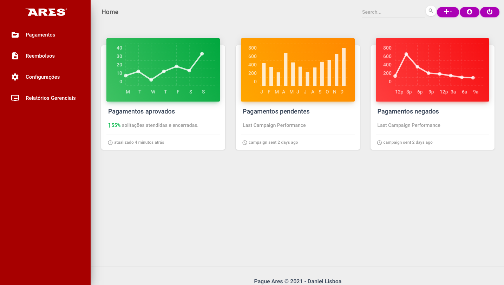

# Pague Ares — Frontend



Interface web (Angular 20 + Angular Material) do sistema de gestão de reembolsos e despesas da Ares. Faz parte do monorepo `pague-ares`; a API ASP.NET Core fica em `../back-end`.

## Pré-requisitos

- Node.js 20.19+ ou 22.12+ (requisito do Angular 20) e npm 9+
- Google Chrome ou Chromium (testes unitários em `ChromeHeadless`)
- API do PagueAres em execução (ver `../back-end/CLAUDE.md`), por padrão em `https://localhost:7219`

## Primeiros passos

```bash
npm ci                  # instala as dependências conforme o package-lock.json
npx ng serve            # servidor de desenvolvimento em http://localhost:4200
```

> **Use sempre `npx ng ...` (ou `npm start`, `npm test`).** Isso garante o Angular CLI local (v20). Um `ng` global de outra versão pode falhar ou gerar resultados diferentes.

O app usa rotas com hash: acesse `http://localhost:4200/#/login`.

## URL da API

A URL da API é lida em tempo de execução de `src/assets/config.json` (`BaseUrl`, padrão `https://localhost:7219`). Para apontar para outra API, edite esse arquivo; não é preciso recompilar um build já publicado. Em Docker, o valor vem da variável `FRONTEND_API_BASE_URL` (vazio = chamadas `/api/*` relativas, via proxy do Nginx).

## Testes

```bash
# Unitários (Karma + Jasmine), execução única
npx ng test --watch=false --browsers=ChromeHeadless

# Sem Google Chrome instalado? Aponte o Karma para o Edge (Chromium):
#   bash:       CHROME_BIN="C:/Program Files (x86)/Microsoft/Edge/Application/msedge.exe" npx ng test --watch=false --browsers=ChromeHeadless
#   PowerShell: $env:CHROME_BIN = "C:\Program Files (x86)\Microsoft\Edge\Application\msedge.exe"

# E2E (Cypress): suba a API e o `ng serve` antes
npm run e2e             # modo headless (cypress run)
npm run e2e:open        # modo interativo
```

Os specs do Cypress ficam em `cypress/e2e/` e assumem o frontend em `http://localhost:4200` e usuários de teste existentes no banco da API.

## Build

```bash
npx ng build --configuration production   # saída em dist/browser/
```

Via Docker, o `Dockerfile` desta pasta gera o build e o serve com Nginx; o `docker-compose.yml` na raiz do monorepo sobe frontend, API e SQL Server juntos.

## Mais informações

Estrutura de pastas, rotas, serviços e componentes: [CLAUDE.md](CLAUDE.md). Visão geral do sistema: [`../DOCUMENTACAO.md`](../DOCUMENTACAO.md).
